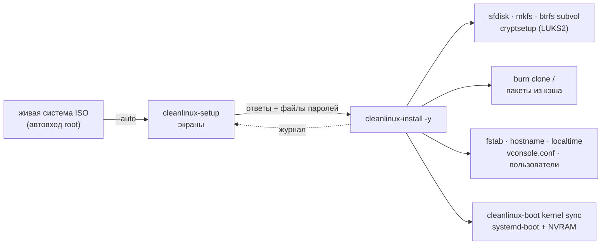

# cleanlinux-install

[](https://github.com/vovawees/cleanlinux-install/releases)
[](LICENSE)


Установщик [CleanLinux](https://github.com/vovawees/CleanLinux): ставит работающую систему на диск — экранами
(`cleanlinux-setup`, его запускает живая система ISO) или одной командой (`cleanlinux-install`, как `pacstrap`
+ `genfstab` в Arch, но целиком и без выбора DE). Пакеты не собираются заново: `burn clone` берёт из кэша ровно
те сборки, что стоят в живой системе.

*English summary: the CleanLinux installer. `cleanlinux-setup` is a small TUI (no ncurses; a Linux VT or a
serial line, 80x24 is enough; English and Russian) that asks for the language, the keymap, the time zone, the
disk, encryption, the user and the passwords and runs `cleanlinux-install`. That one erases a disk (GPT, an EFI
system partition and btrfs with the subvolumes `@`, `@home`, `@snapshots`, inside LUKS2 with `--encrypt`) or
uses filesystems already mounted at `--target`; installs the very package builds of the running system
(`burn clone`), writes fstab by PARTUUID, the kernel command line, hostname, time zone, console keymap and
font, passwords (yescrypt) and a user, enables dhcpcd (and iwd with Wi-Fi), puts the kernel into the ESP for
the boot loader of the device (systemd-boot with an EFI boot entry; U-Boot extlinux, the Raspberry Pi
firmware or an Android boot image when the profile says so). C17, libblkid, libxcrypt. MIT.*

## Содержание

- [Установщик с экранами: cleanlinux-setup](#установщик-с-экранами-cleanlinux-setup)
- [Установка одной командой: cleanlinux-install](#установка-одной-командой-cleanlinux-install)
- [Что делает](#что-делает)
- [Устройство](#устройство)
- [Сборка и тесты](#сборка-и-тесты)
- [Лицензия](#лицензия)

## Установщик с экранами: cleanlinux-setup

Живая система ISO CleanLinux входит под root и сама открывает `cleanlinux-setup --auto` на основной консоли
(на экране или на последовательном порту, если загрузились с `console=ttyS0`). Вручную — просто
`cleanlinux-setup`. Экраны:

| # | Экран | Что выбирается |
|---|---|---|
| 1 | Language · Язык | English или русский (шрифт консоли с кириллицей грузится сразу) |
| 2 | Добро пожаловать | что будет: диск стирается, нужен UEFI, Secure Boot выключен; предупреждение, если загрузились не в UEFI |
| 3 | Раскладка клавиатуры | 23 раскладки kbd (`us`, `ruwin_alt_sh-UTF-8` — Alt+Shift, `de-latin1`, …), включается сразу (`loadkeys`) |
| 4 | Часовой пояс | часть света → город (из `zone.tab` tzdata) или UTC; поиск по мере набора, и по-русски, и латиницей |
| 5 | Диск | все диски с размером, моделью, шиной и тем, что на них сейчас (`ntfs, vfat`…); носитель установки, занятые и меньше 3.5 GiB выбрать нельзя |
| 6 | Шифрование | без него или LUKS2 с паролем (латиница: при загрузке раскладка US) |
| 7 | Компьютер и пользователь | имя компьютера, имя пользователя (в `wheel`), пароль дважды |
| 8 | Администратор (root) | тот же пароль, что у пользователя, или свой |
| 9 | Оборудование | только если `burn profile detect` узнал устройство: его профиль для `burn update` |
| 10 | Всё готово к установке | сводка; «Установить» → «Стереть диск?» (по умолчанию — «Назад») |

```text
 Установка CleanLinux                                               шаг 10 из 10
 ┌─ Всё готово к установке ───────────────────────────────────────────────────┐
 │                                                                            │
 │ Диск:         /dev/nvme0n1  Samsung SSD 980  931.5 GiB                     │
 │ Шифрование:   да (LUKS2)                                                   │
 │ Клавиатура:   Русская (ruwin_alt_sh-UTF-8)                                 │
 │ Часовой пояс: Europe/Moscow                                                │
 │ Компьютер:    cleanlinux                                                   │
 │ Пользователь: anna                                                         │
 │ root:         пароль пользователя                                          │
 │ Профиль:      generic-x86_64                                               │
 │                                                                            │
 │ ВСЕ ДАННЫЕ НА /dev/nvme0n1 БУДУТ СТЁРТЫ.                                   │
 │                                                                            │
 │ [ Установить ]  [ Назад ]                                                  │
 └────────────────────────────────────────────────────────────────────────────┘
 ←→ выбор · Enter подтвердить · Esc назад
```

Управление: ↑↓ и Enter, Esc — назад, Tab — следующее поле, Ctrl+C — выйти (до подтверждения на дисках ничего
не меняется). Потом — экран с ходом установки (шаги, «пакеты: 41 из 97», полоса и хвост журнала
`/tmp/cleanlinux-install.log`) и выбор: перезагрузить, выключить или выйти в консоль.

| Ключ | Что |
|---|---|
| `--lang en\|ru` | язык (первый экран всё равно спрашивает) |
| `--ascii` | рамки и стрелки ASCII (сами включаются для `TERM=vt100` и если в шрифте консоли нет символов) |
| `-n`, `--dry-run` | `cleanlinux-install -n`: показать план; работает и без root |
| `--auto` | автозапуск живой системы: только на основной консоли и не снова после выхода |

Пароли уходят установщику в файлах в каталоге 0700 в `/run` и затираются нулями сразу после установки;
`console=`, `nomodeset` и `*.modeset=` текущей загрузки переходят в командную строку новой системы
(последовательная консоль и «безопасная графика» ISO сохраняются).

## Установка одной командой: cleanlinux-install

```sh
cleanlinux-install /dev/nvme0n1                      # спросит подтверждение и пароль root
cleanlinux-install --user anna --hostname deck /dev/sda
cleanlinux-install --encrypt /dev/nvme0n1            # корень в LUKS2: пароль спросит initramfs при загрузке
cleanlinux-install --dry-run /dev/sda                # показать план, ничего не меняя
cleanlinux-install --timezone Europe/Moscow --keymap ruwin_alt_sh-UTF-8 --font cyr-sun16 /dev/sda
cleanlinux-install --target /mnt                     # своя разметка: смонтировано в /mnt, ESP в /mnt/boot
```

С диском установщик **стирает его целиком**:

| Раздел | Размер | ФС | Куда |
|---|---|---|---|
| 1, EFI system partition | 512 MiB (`--esp-size`) | vfat | `/boot` |
| 2, корень (тип из Discoverable Partitions Spec для архитектуры) | остальное | btrfs, zstd (с `--encrypt` — внутри LUKS2) | `@` → `/`, `@home` → `/home`, `@snapshots` → `/.snapshots` |

Снимки burn перед каждым `update` ложатся в `@snapshots`. Без диска (`--target`) установщик берёт то, что
уже смонтировано: корень и любые другие ФС ниже `--target`, ESP — vfat в `/boot`, `/efi` или `/boot/efi`.

## Что делает

1. Проверяет диск: целый диск, а не раздел; не только для чтения; не занят — ядро не даёт эксклюзивно
   открыть диск, если раздел смонтирован, это swap или его держит device mapper, так что диск живой системы
   не выбрать по ошибке.
2. Предлагает профиль железа: `burn profile detect` узнаёт устройство (DMI, device tree), и если это не тот профиль,
   под который собрана живая система (образ — `generic-x86_64`), спрашивает, взять ли его для новой системы
   (`burn update` потом пересоберёт её под это устройство); без терминала или с `--yes` только показывает
   подсказку, `--profile` выбирает сам.
3. Спрашивает подтверждение (`--yes` — без него) и пароли — до того, как что-то изменится.
4. Размечает (`sfdisk`, свои случайные PARTUUID), форматирует (`mkfs.vfat`, `mkfs.btrfs`), создаёт подтома
   ioctl-ом btrfs и монтирует новую систему в `--target`. С `--encrypt` раздел корня — контейнер LUKS2
   (`cryptsetup luksFormat`, argon2id, метка `CleanLinux`), btrfs — внутри; он открыт как
   `/dev/mapper/luks-<UUID>`, так же его назовёт initramfs новой системы, и так он записан в fstab.
5. Пишет `/etc/kernel/cmdline` (`root=PARTUUID=… rootflags=subvol=@ rootwait ro` + `--cmdline`; для
   зашифрованного корня — `rd.luks.uuid=<UUID> root=/dev/mapper/luks-<UUID> …` и
   `/etc/cleanlinux/initramfs.d/50-luks-root.conf`: `modules=dm-crypt`, `files=/usr/bin/cryptsetup`) — до
   пакетов, чтобы триггер ядра сразу написал верную запись загрузчика и собрал initramfs.
6. `burn -r /mnt -y clone /`: все пакеты живой системы (или `--packages` с зависимостями) из
   `/var/cache/burn/packages`, в порядке зависимостей, с триггерами (ldconfig, depmod, hwdb, sysusers, ядро в ESP).
7. Настраивает: `fstab` по PARTUUID, `hostname`, часовой пояс (`/etc/localtime` → `--timezone`, иначе как в
   живой системе) и консоль (`/etc/vconsole.conf`: `KEYMAP=`/`FONT=` из `--keymap`/`--font`; их применяет
   `cleanlinux-boot vconsole` при загрузке), `burn.conf` живой системы (профиль — `--profile`), пароль root
   и пользователь в группах `wheel`, `audio`, `video` и `seat` — тех, что есть в новой системе (без logind звук
   и место seatd даются группами; `useradd -R`, хэш yescrypt из libxcrypt), сервисы dinit: `dhcpcd`, а при Wi-Fi —
   `iwd` и известные живой системе сети.
8. `cleanlinux-boot --root /mnt kernel sync`: ядро (и initramfs, если корень зашифрован) в ESP под загрузчик устройства (`loader=` из `boot.d`
   новой системы — его ставит пакет `hardware` по `BOOTLOADER` профиля). Для systemd-boot — записи, сам
   загрузчик и запись `CleanLinux` в NVRAM (efivarfs, первой в `BootOrder`; без неё прошивка всё равно найдёт
   `EFI/BOOT/BOOTX64.EFI`); для U-Boot — `extlinux/extlinux.conf`, для Raspberry Pi — `config.txt`; для
   устройств с ABL — Android boot image в `/var/lib/cleanlinux/android/`, его остаётся прошить в раздел `boot`
   (`android.partition=` и `cleanlinux-boot kernel sync --flash` или `fastboot flash boot`).
9. Отмонтирует и закрывает контейнер LUKS (`--keep-mounted` — оставить).

Пароли берутся с терминала или из файла (`--root-password-file`, `--user-password-file`,
`--encrypt-password-file`, `-` — stdin): так установку можно автоматизировать. Пароль LUKS передаётся
cryptsetup через stdin как есть (без перевода строки — те же байты, что набираются при загрузке) и нигде
не печатается.

Со своей разметкой (`--target`) корень может быть открытым контейнером LUKS (`cryptsetup open` до
`mount`): установщик узнаёт его по device mapper (`CRYPT-LUKS2-…`) и делает то же, что с `--encrypt`.
Другие зашифрованные ФС при загрузке не открываются (crypttab нет), LVM не поддерживается.

## Устройство



```text
cleanlinux-install/
├── src/
│   ├── main.c         cleanlinux-install: ключи, шаги установки
│   ├── plan.c         чистые функции: sfdisk, fstab, cmdline, shadow, conf, ход установки
│   ├── system.c       что трогает машину: диски, blkid, mount, crypt, kbd
│   ├── util.c/.h      строки, файлы, запуск программ
│   ├── setup.c        cleanlinux-setup: экраны
│   ├── setup_text.h   все надписи, English и русский
│   └── tui.c/.h       терминал: raw-режим, буфер ячеек, клавиши, UTF-8, проверка глифов шрифта VT
└── tests/
    ├── unit.c         plan.c и перенос текста
    ├── cli.sh         ключи и --dry-run на настоящем диске (только чтение)
    └── setup.py       экраны в псевдотерминале: эмулятор экрана, поддельные диски и установщик
```

## Сборка и тесты

```sh
make && make check       # unit-тесты, командная строка и экраны (python3), без root
make install DESTDIR=… PREFIX=/usr
```

`tests/setup.py` проходит экраны как человек: псевдотерминал, крошечный эмулятор VT, поддельные диски
(`CLEANLINUX_SETUP_DISKS="vdb=20480=QEMU HARDDISK=ext4"`), свои раскладки и `zone.tab`
(`CLEANLINUX_SETUP_DATA`) и поддельный установщик (`CLEANLINUX_SETUP_INSTALLER`), который проверяет
аргументы и файлы паролей: английский путь без шифрования, русский с LUKS2, отдельным паролем root,
ошибкой установки, `--ascii` и сменой размера терминала, «нет дисков» и выход по Ctrl+C.

Нужны libblkid (util-linux) и libxcrypt; на устройстве — burn, cleanlinux-boot, util-linux (`sfdisk`),
dosfstools, btrfs-progs и shadow (`useradd`) — всё это есть в `base`, — и cryptsetup для `--encrypt`
(зависимость пакета `cleanlinux-install`). Настоящая установка проверяется в
CleanLinux: `tests/install.py` загружает образ в QEMU, ставит систему на второй диск и загружается с него
(`--encrypt` — то же с корнем в LUKS2 и вводом пароля в initramfs), а `tests/iso.py` — весь путь с ISO:
загрузка с «флешки» (USB в QEMU), экраны `cleanlinux-setup` на последовательной консоли, установка и
загрузка установленной системы.

## Лицензия

MIT
