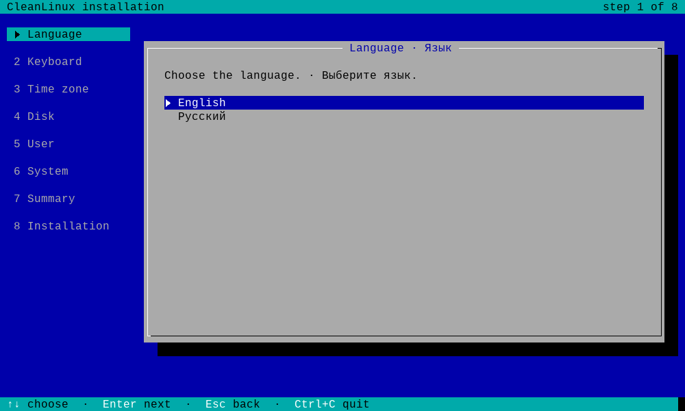
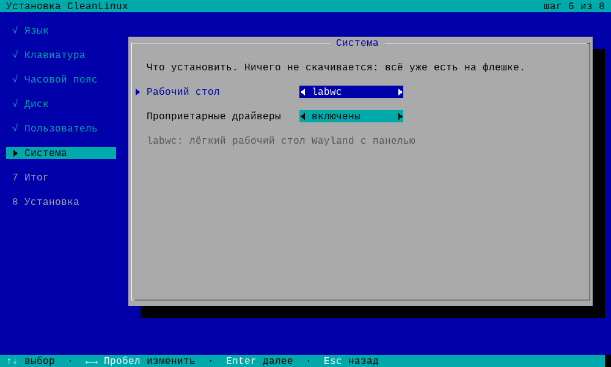
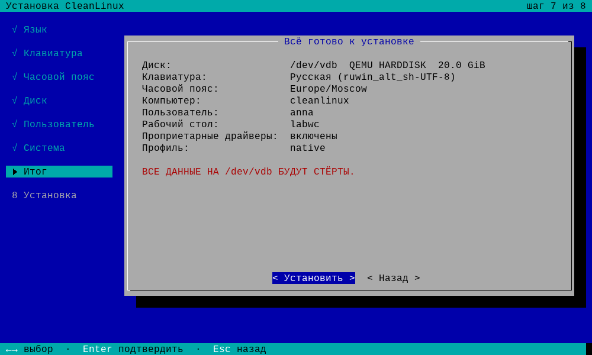
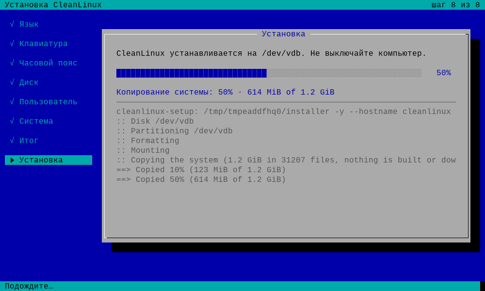
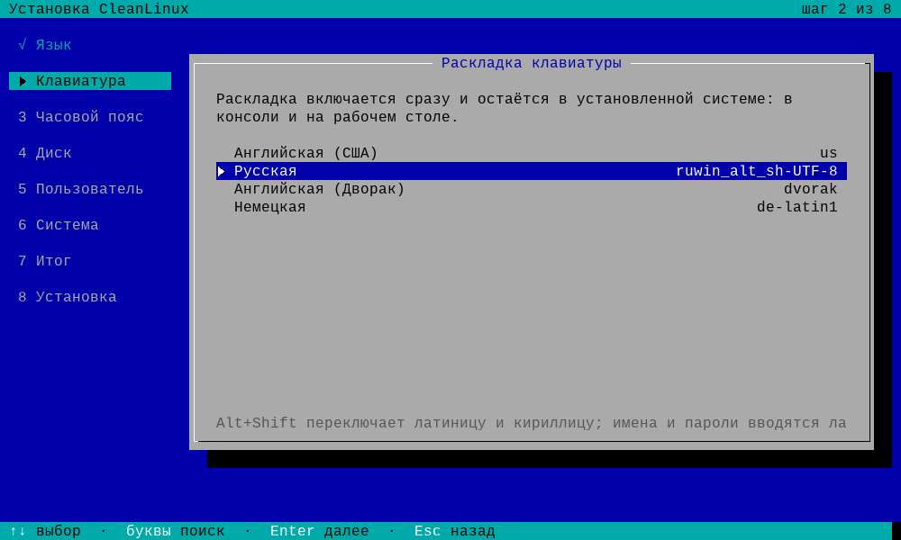
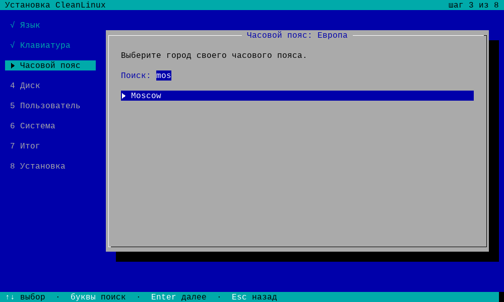
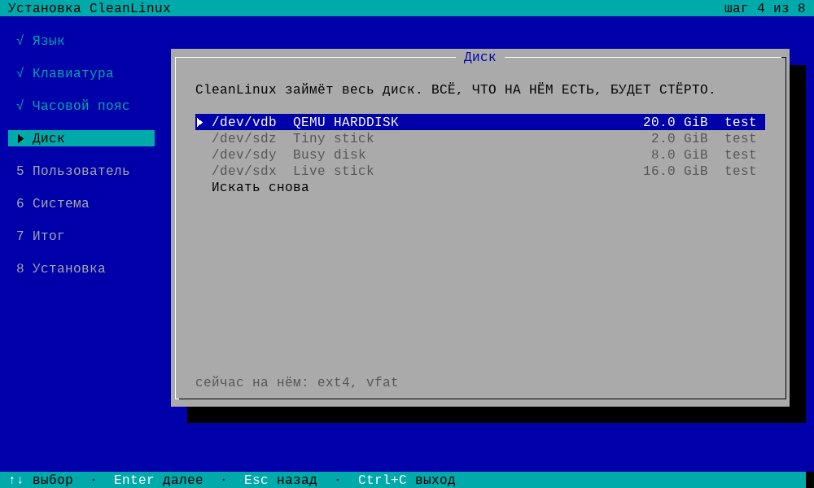
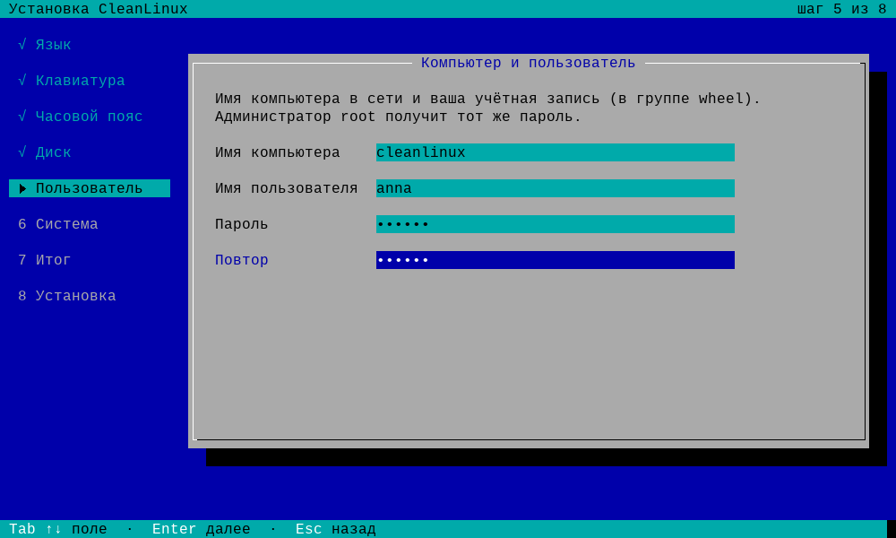
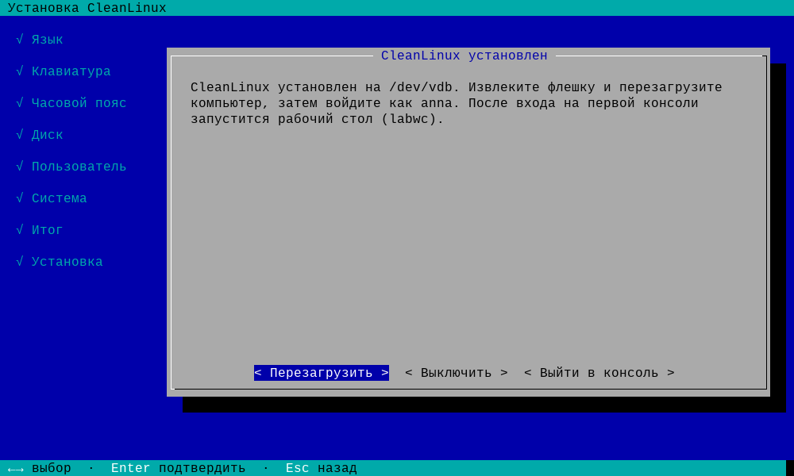
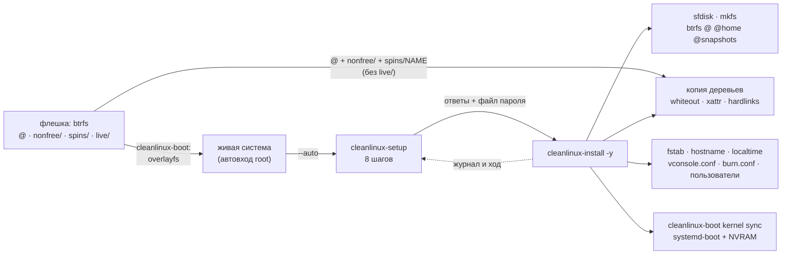

# cleanlinux-install

[](https://github.com/vovawees/cleanlinux-install/releases)
[](LICENSE)


Установщик [CleanLinux](https://github.com/vovawees/CleanLinux): ставит систему с живой флешки на диск —
экранами (`cleanlinux-setup`, его открывает живая система) или одной командой (`cleanlinux-install`, как
`pacstrap` + `genfstab` в Arch, но целиком). **Ничего не собирается и не скачивается:** система копируется с
флешки как есть — дерево `@` и слои над ним: проприетарные драйверы (`nonfree/`, включены по умолчанию) и,
по выбору, рабочий стол (`spins/labwc/`). Минута-две на SSD вместо часа сборки.

*English summary: the CleanLinux installer. `cleanlinux-setup` is a small TUI (no ncurses; a Linux VT or a
serial line, 80x24 is enough; English and Russian; the eight steps listed on the left of a large screen):
the language, the keymap, the time zone, the disk, the computer and the user (root gets the same password),
the system (a desktop spin such as labwc or the console only, the proprietary drivers on or off, the device
profile), a summary, the installation. `cleanlinux-install` erases a disk (GPT, an EFI system partition and
btrfs with the subvolumes `@`, `@home`, `@snapshots`) or uses filesystems already mounted at `--target`;
copies the system of the live medium as overlayfs shows it (its tree `@`, the `nonfree/` layer unless
`--no-nonfree`, a spin with `--spin NAME`: owners, modes, xattrs, hard links, whiteouts), or installs the
packages of the running system with `burn clone`; writes fstab by PARTUUID, the kernel command line,
hostname, time zone, console keymap and font, burn.conf (the profile, `ALLOW_NONFREE`), passwords (yescrypt)
and a user, enables dhcpcd (and iwd with Wi-Fi), puts the kernel into the ESP for the boot loader of the
device (systemd-boot with an EFI boot entry; U-Boot extlinux, the Raspberry Pi firmware or an Android boot
image when the profile says so). No disk encryption: the base system has none. C17, libblkid, libxcrypt. MIT.*

## Содержание

- [Установщик с экранами: cleanlinux-setup](#установщик-с-экранами-cleanlinux-setup)
- [Установка одной командой: cleanlinux-install](#установка-одной-командой-cleanlinux-install)
- [Откуда берётся система](#откуда-берётся-система)
- [Что делает](#что-делает)
- [Устройство](#устройство)
- [Сборка и тесты](#сборка-и-тесты)
- [Лицензия](#лицензия)

## Установщик с экранами: cleanlinux-setup

Живая система CleanLinux входит под root и сама открывает `cleanlinux-setup --auto` на основной консоли (на
экране или на последовательном порту, если загрузились с `console=ttyS0`); на рабочем столе labwc — пункт
меню «Установить CleanLinux». Вручную — просто `cleanlinux-setup`.

| | |
|:---:|:---:|
|  |  |
| **1. Язык** — шаги слева, подсказки клавиш внизу | **6. Система** — рабочий стол, драйверы, профиль |
|  |  |
| **7. Итог** — всё на одном экране, затем «Стереть диск?» | **8. Установка** — копирование с полосой и журналом |

<details>
<summary>Все экраны</summary>







</details>

| # | Шаг | Что выбирается |
|---|---|---|
| 1 | Язык · Language | English или русский (шрифт консоли с кириллицей грузится сразу); предупреждение, если загрузились не в UEFI |
| 2 | Клавиатура | 23 раскладки kbd (`us`, `ruwin_alt_sh-UTF-8` — Alt+Shift, `de-latin1`, …), включается сразу (`loadkeys`) и переходит и в консоль, и на рабочий стол |
| 3 | Часовой пояс | часть света → город (из `zone.tab` tzdata) или UTC; поиск по мере набора, и по-русски, и латиницей |
| 4 | Диск | все диски с размером, моделью, шиной и тем, что на них сейчас (`ntfs, vfat`…); носитель установки, занятые и меньше 3.5 GiB выбрать нельзя |
| 5 | Пользователь | имя компьютера, имя пользователя (в `wheel`), пароль дважды; root получает тот же пароль |
| 6 | Система | **рабочий стол** — спины с флешки (`labwc`) или «нет (консоль)»; **проприетарные драйверы** — включены/выключены (`ALLOW_NONFREE`); **профиль** — если `burn profile detect` узнал устройство; **автоматический вход** — пользователь входит на tty1 сам и рабочий стол открывается сразу (по умолчанию включён для портативных консолей: у их профиля есть `handheld`) |
| 7 | Итог | сводка; «Установить» → «Стереть диск?» (по умолчанию — «Назад») |
| 8 | Установка | шаги, «Копирование системы: 50% · 614 MiB of 1.2 GiB», полоса и хвост журнала; затем перезагрузить, выключить или выйти в консоль |

Управление: ↑↓ и Enter, ←→ или Пробел меняют значение на экране «Система», Esc — назад, Tab — следующее
поле, Ctrl+C — выйти (до подтверждения на дисках ничего не меняется). На экране от 84×18 слева виден список
шагов (√ — пройден, ▶ — текущий), на 80×24 — только панель.

| Ключ | Что |
|---|---|
| `--lang en\|ru` | язык (первый экран всё равно спрашивает) |
| `--ascii` | рамки и стрелки ASCII (сами включаются для `TERM=vt100` и если в шрифте консоли нет символов) |
| `-n`, `--dry-run` | `cleanlinux-install -n`: показать план; работает и без root |
| `--auto` | автозапуск живой системы: только на основной консоли и не снова после выхода |

Пароль уходит установщику в файлах в каталоге 0700 в `/run` и затирается нулями сразу после установки;
`console=`, `nomodeset` и `*.modeset=` текущей загрузки переходят в командную строку новой системы
(последовательная консоль и «безопасная графика» живой системы сохраняются).

## Установка одной командой: cleanlinux-install

```sh
cleanlinux-install /dev/nvme0n1                      # спросит подтверждение и пароль root
cleanlinux-install --user anna --hostname deck --spin labwc /dev/sda   # с рабочим столом labwc
cleanlinux-install --user anna --autologin --spin labwc /dev/mmcblk0   # консоль: вход и рабочий стол сами
cleanlinux-install --no-nonfree /dev/sda             # только свободное ПО (ALLOW_NONFREE=0)
cleanlinux-install --dry-run /dev/sda                # показать план, ничего не меняя
cleanlinux-install --timezone Europe/Moscow --keymap ruwin_alt_sh-UTF-8 --font cyr-sun16 /dev/sda
cleanlinux-install --target /mnt                     # своя разметка: смонтировано в /mnt, ESP в /mnt/boot
cleanlinux-install --clone -p "base linux" /dev/sda  # пакетами burn clone вместо копии
```

С диском установщик **стирает его целиком**:

| Раздел | Размер | ФС | Куда |
|---|---|---|---|
| 1, EFI system partition | 512 MiB (`--esp-size`) | vfat | `/boot` |
| 2, корень (тип из Discoverable Partitions Spec для архитектуры) | остальное | btrfs, zstd | `@` → `/`, `@home` → `/home`, `@snapshots` → `/.snapshots` |

Снимки burn перед каждым `update` ложатся в `@snapshots`. Без диска (`--target`) установщик берёт то, что
уже смонтировано: корень и любые другие ФС ниже `--target`, ESP — vfat в `/boot`, `/efi` или `/boot/efi`.
Шифрования диска нет: в базовой системе его нет (ни cryptsetup, ни LUKS в initramfs).

| Ключ | Что |
|---|---|
| `-s`, `--spin NAME` | ещё и спин `NAME` с флешки (`spins/NAME/`: `labwc`) |
| `--no-nonfree` / `--nonfree` | без слоя проприетарных драйверов и `ALLOW_NONFREE=0` / с ним (по умолчанию) |
| `--source DIR` | копировать дерево `DIR` (и `nonfree/`, `spins/` рядом с ним) вместо `/run/cleanlinux/live/medium/@` |
| `--clone`, `-p "PKG…"` | `burn clone` пакетов живой системы (или только `PKG` с зависимостями) вместо копии |
| `--profile NAME` | профиль устройства для `burn update` (иначе подсказка из `burn profile detect`) |
| `--hostname`, `--user`, `--timezone`, `--keymap`, `--font`, `--cmdline` | имя, пользователь, пояс, консоль, доп. аргументы ядра |
| `--root-password-file`, `--user-password-file` | пароли из файлов (`-` — stdin) для автоматизации |
| `--autologin` | пользователь (`--user`) входит на tty1 сам, без пароля: `/etc/cleanlinux/autologin` для getty из cleanlinux-boot 0.5.1 (`cleanlinux.autologin=0` в строке ядра отключает) |
| `-t DIR`, `--esp-size MiB`, `--keep-mounted`, `--no-efi-entry`, `-y`, `-n` | цель, ESP, не отмонтировать, без записи NVRAM, без вопросов, пробный запуск |

## Откуда берётся система

Живой образ — один раздел btrfs (или ext4) без squashfs и без ISO9660: `cleanlinux-boot` монтирует его в
`/run/cleanlinux/live/medium` и собирает корень overlayfs из слоёв. Установщик копирует **те же слои, кроме
`live/`** (автовход и прочие настройки живой сессии в новую систему не попадают):

```text
/run/cleanlinux/live/medium/
├── @/                чистая система: base, ядро, прошивки (без кэша пакетов)
├── nonfree/          проприетарные драйверы и прошивки (например, steamdeck-dsp) — по умолчанию
├── spins/labwc/      рабочий стол labwc + sfwbar, экранная клавиатура, поворот экрана — по выбору
└── live/             только для живой сессии: автовход root, hostname cleanlinux-live
```

Копия — как overlayfs показывает слои: whiteout (символьное устройство 0:0) удаляет то, что ниже,
непрозрачный каталог (`trusted.overlay.opaque=y`) заменяет его; владельцы, права, времена, xattr (кроме
`trusted.overlay.*`), жёсткие ссылки, устройства и FIFO сохраняются, `copy_file_range` — без копирования
через память. Без флешки (или с `--clone`) пакеты ставит `burn clone /` из кэша `/var/cache/burn/packages`.

## Что делает

1. Проверяет диск: целый диск, а не раздел; не только для чтения; не занят — ядро не даёт эксклюзивно
   открыть диск, если раздел смонтирован, это swap или его держит device mapper, так что флешку живой
   системы не выбрать по ошибке.
2. Предлагает профиль железа: `burn profile detect` узнаёт устройство (DMI, device tree), и если это не тот
   профиль, под который собран образ (`generic-x86_64`, `generic-aarch64`), предлагает его для новой системы
   (`burn update` потом пересоберёт её под это устройство); без терминала или с `--yes` только показывает
   подсказку, `--profile` выбирает сам.
3. Спрашивает подтверждение (`--yes` — без него) и пароли — до того, как что-то изменится.
4. Размечает (`sfdisk`, свои случайные PARTUUID), форматирует (`mkfs.vfat`, `mkfs.btrfs`), создаёт подтома
   ioctl-ом btrfs и монтирует новую систему в `--target`.
5. Копирует систему: `@`, затем `nonfree/` и спин — «Copied 50% (614 MiB of 1.2 GiB)» по мере копирования
   (с `--clone` — `burn -r /mnt -y clone /`, пакеты из кэша в порядке зависимостей с триггерами).
6. Пишет `/etc/kernel/cmdline`: `root=PARTUUID=… rootflags=subvol=@ rootwait ro` + `--cmdline`.
7. Настраивает: `fstab` по PARTUUID, `hostname`, часовой пояс (`/etc/localtime` → `--timezone`, иначе как в
   живой системе) и консоль (`/etc/vconsole.conf`: `KEYMAP=`/`FONT=` из `--keymap`/`--font`; их применяет
   `cleanlinux-boot vconsole` при загрузке, а сессия labwc берёт оттуда раскладку XKB), `burn.conf` (профиль —
   `--profile`, тогда список `FIRMWARE=` образа закомментирован и прошивки берутся по профилю устройства;
   `ALLOW_NONFREE=1` или `0`), пароль root и пользователь в группах `wheel`, `audio`, `video`, `render`,
   `input` и `seat` — тех, что есть в новой системе (без logind звук, GPU, сенсорный экран и место seatd
   даются группами; `useradd -R`, хэш yescrypt из libxcrypt), сервисы dinit: `dhcpcd`, а при Wi-Fi — `iwd` и
   известные живой системе сети.
8. `cleanlinux-boot --root /mnt kernel sync`: ядро и initramfs в ESP под загрузчик устройства (`loader=` из
   `boot.d` новой системы — его ставит пакет `hardware` по `BOOTLOADER` профиля). Для systemd-boot — записи,
   сам загрузчик и запись `CleanLinux` в NVRAM (efivarfs, первой в `BootOrder`; без неё прошивка всё равно
   найдёт `EFI/BOOT/BOOTX64.EFI` или `BOOTAA64.EFI`); для U-Boot — `extlinux/extlinux.conf`, для Raspberry Pi —
   `config.txt`; для устройств с ABL — Android boot image в `/var/lib/cleanlinux/android/`, его остаётся прошить
   в раздел `boot` (`android.partition=` и `cleanlinux-boot kernel sync --flash` или `fastboot flash boot`).
9. Отмонтирует (`--keep-mounted` — оставить).

Пароли берутся с терминала или из файла (`--root-password-file`, `--user-password-file`, `-` — stdin): так
установку можно автоматизировать; в журнал и на экран они не попадают.

## Устройство



```text
cleanlinux-install/
├── src/
│   ├── main.c         cleanlinux-install: ключи, шаги установки, слои флешки
│   ├── copy.c         копия деревьев как overlayfs: whiteout, opaque, xattr, жёсткие ссылки, ход
│   ├── plan.c         чистые функции: sfdisk, fstab, cmdline, shadow, conf, ход установки
│   ├── system.c       что трогает машину: диски, blkid, mount, kbd
│   ├── util.c/.h      строки, файлы, запуск программ
│   ├── setup.c        cleanlinux-setup: экраны, список шагов, экран «Система»
│   ├── setup_text.h   все надписи, English и русский
│   └── tui.c/.h       терминал: raw-режим, буфер ячеек, панели с тенью, клавиши, UTF-8, глифы шрифта VT
├── tests/
│   ├── unit.c         plan.c, copy.c (во временном каталоге) и перенос текста
│   ├── cli.sh         ключи и --dry-run на настоящем диске (только чтение), копия поддельной флешки
│   └── setup.py       экраны в псевдотерминале: эмулятор экрана, поддельные диски, флешка и установщик
├── tools/screens.py   картинки экранов для README (цвета консоли Linux)
└── docs/screens/      эти картинки
```

## Сборка и тесты

```sh
make && make check       # unit-тесты, командная строка и экраны (python3), без root
make install DESTDIR=… PREFIX=/usr
sudo python3 tools/screens.py docs/screens   # картинки экранов
```

`tests/setup.py` проходит экраны как человек: псевдотерминал, крошечный эмулятор VT, поддельные диски
(`CLEANLINUX_SETUP_DISKS="vdb=20480=QEMU HARDDISK=ext4"`), свои раскладки и `zone.tab`
(`CLEANLINUX_SETUP_DATA`), поддельная флешка со спином labwc и `nonfree/` (`CLEANLINUX_SETUP_MEDIUM`) и
поддельный установщик (`CLEANLINUX_SETUP_INSTALLER`), который проверяет аргументы и файлы паролей:
английский путь с labwc и без проприетарных драйверов, русский — только консоль, ошибка установки, `--ascii`
и смена размера терминала (появляется список шагов), «нет дисков» и выход по Ctrl+C.

Нужны libblkid (util-linux) и libxcrypt; на устройстве — cleanlinux-boot, util-linux (`sfdisk`), dosfstools,
btrfs-progs и shadow (`useradd`), для `--clone` — burn; всё это есть в `base`. Настоящая установка
проверяется в CleanLinux: `tests/install.py` загружает образ в QEMU, ставит систему на второй диск и
загружается с него, а `tests/live.py` — весь путь с живого образа: загрузка с «флешки», экраны
`cleanlinux-setup` на последовательной консоли, копия на диск и загрузка установленной системы.

## Лицензия

MIT
